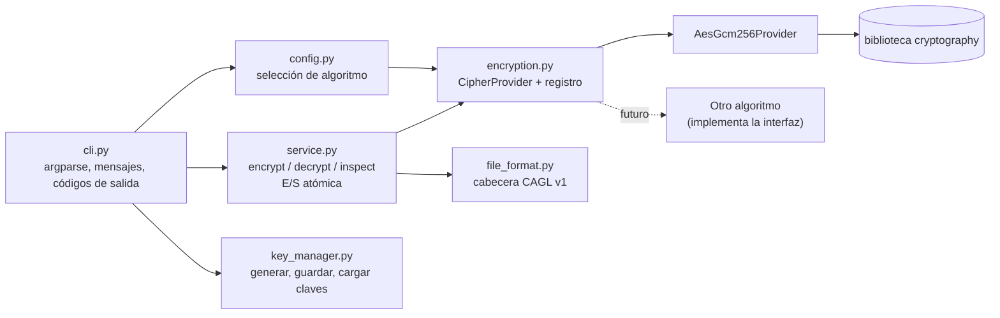
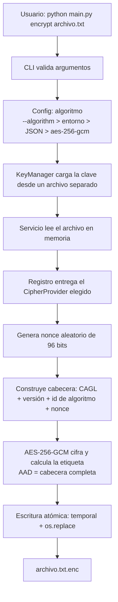

# CryptoAgility Lab — Cifrado Seguro de Archivos y Agilidad Criptográfica

Laboratorio educativo de **criptografía aplicada** en Python: cifrado de archivos con **AES-256-GCM**, verificación de integridad, gestión básica de claves y una arquitectura que demuestra el concepto de **agilidad criptográfica**.

> ## Aviso importante
> Este es un **proyecto educativo**. **No ha sido auditado** y **no debe usarse para proteger información real en producción**. Está pensado para aprender, demostrar conocimientos y discutir decisiones de diseño. No implementa criptografía poscuántica ni afirma hacerlo (ver [Agilidad criptográfica](#agilidad-criptográfica)).

---

## Índice

1. [Descripción y objetivos](#descripción-y-objetivos)
2. [Características](#características)
3. [Tecnologías](#tecnologías)
4. [Arquitectura](#arquitectura)
5. [Formato del archivo cifrado](#formato-del-archivo-cifrado)
6. [Instalación](#instalación)
7. [Uso](#uso)
8. [Ejemplo de sesión en terminal](#ejemplo-de-sesión-en-terminal)
9. [AES-256-GCM explicado](#aes-256-gcm-explicado)
10. [Confidencialidad e integridad](#confidencialidad-e-integridad)
11. [Gestión de claves](#gestión-de-claves)
12. [Agilidad criptográfica](#agilidad-criptográfica)
13. [Modelo de amenazas](#modelo-de-amenazas)
14. [Limitaciones](#limitaciones)
15. [Pruebas](#pruebas)
16. [Mejoras futuras](#mejoras-futuras)
17. [Estructura del repositorio](#estructura-del-repositorio)
18. [Licencia](#licencia)

---

## Descripción y objetivos

CryptoAgility Lab es una herramienta de línea de comandos que cifra y descifra archivos locales con cifrado autenticado (AEAD). Se construyó como ejercicio para demostrar, con código limpio y probado:

- **Python moderno** (3.11+, *type hints*, *docstrings*, validación de entradas, errores claros).
- **Uso correcto de criptografía**: primitivas de una biblioteca reconocida (`cryptography`), nonces aleatorios únicos, autenticación antes de revelar datos. **No se inventa ningún algoritmo.**
- **Integridad de datos**: cualquier alteración del archivo cifrado o uso de una clave incorrecta se detecta y **no produce ningún archivo de salida**.
- **Gestión básica de claves**: generación segura, separación clave/datos, sin claves en el código, en consola ni en logs.
- **Agilidad criptográfica**: el algoritmo está desacoplado del resto de la aplicación, se elige por configuración y queda registrado en la cabecera del archivo.

## Características

| Función | Detalle |
|---|---|
| Cifrado | AES-256-GCM, nonce aleatorio de 96 bits por cifrado, salida `archivo.ext.enc` |
| Descifrado | Verifica la etiqueta de autenticación **antes** de escribir nada; escritura atómica |
| Claves | 256 bits del CSPRNG del SO, archivo aparte (`keys/`), permisos 0600 en POSIX, sin sobrescritura accidental |
| Inspección | `inspect` muestra versión de formato, algoritmo y tamaños sin necesidad de clave |
| Agilidad | Interfaz `CipherProvider` + registro de algoritmos + id de algoritmo en la cabecera |
| Configuración | `--algorithm`, variable de entorno `CRYPTOAGILITY_ALGORITHM` o archivo JSON |
| Pruebas | 138 pruebas con pytest, incluidos vectores de prueba oficiales de GCM |

## Tecnologías

- Python ≥ 3.11
- [`cryptography`](https://cryptography.io): se usa la interfaz AEAD `AESGCM` (vive en el módulo `hazmat`, pero expone una API de cifrado autenticado que gestiona la etiqueta por ti)
- `argparse` (CLI), `pytest` (pruebas)
- Git y GitHub (con GitHub Actions para ejecutar las pruebas en Windows y Linux)

## Arquitectura



| Módulo | Responsabilidad |
|---|---|
| `cli.py` | Interfaz de usuario. No contiene lógica criptográfica. Traduce excepciones a mensajes y códigos de salida. |
| `service.py` | Orquesta el flujo: lee, cifra/descifra, escribe de forma atómica. No conoce AES, solo `CipherProvider`. |
| `encryption.py` | Contrato `CipherProvider`, implementación AES-256-GCM y registro de algoritmos. **Único** módulo que toca primitivas. |
| `file_format.py` | Serialización y validación estricta de la cabecera. |
| `key_manager.py` | Ciclo de vida básico de la clave (generar, guardar, cargar, validar). |
| `config.py` | Resuelve qué algoritmo usar al cifrar. |
| `exceptions.py` | Jerarquía de errores propios. |

Más detalle en [`docs/arquitectura.md`](docs/arquitectura.md).

### Flujo de cifrado



### Flujo de descifrado

```mermaid
flowchart TD
    A["Usuario: python main.py decrypt archivo.txt.enc"] --> B["Lee archivo y valida cabecera<br/>firma, versión, longitudes"]
    B --> C["Busca algoritmo por el id de la cabecera"]
    C --> D["AES-256-GCM verifica la etiqueta<br/>sobre cabecera + texto cifrado"]
    D -->|"Etiqueta válida"| E["Texto plano en memoria"]
    E --> F["Escritura atómica del archivo descifrado"]
    D -->|"Clave incorrecta o archivo alterado"| G["AuthenticationError<br/>código de salida 3<br/>NO se escribe nada"]
```



## Formato del archivo cifrado

```
Offset  Tamaño  Campo
0       4       Firma "CAGL"
4       1       Versión del formato (1)
5       1       Id del algoritmo (1 = aes-256-gcm)
6       1       Longitud del nonce (N)
7       N       Nonce (12 bytes en AES-GCM)
7+N     ...     Texto cifrado || etiqueta de autenticación (16 bytes)
```

La **cabecera completa se autentica como AAD** (*Additional Authenticated Data*): viaja en claro (así `inspect` puede leerla) pero no se puede modificar sin que falle la verificación. **La clave nunca forma parte del archivo.**

## Instalación

Requisitos: **Python 3.11 o superior** y Git.

Guía detallada para Windows + Visual Studio Code: [`docs/instalacion-windows-vscode.md`](docs/instalacion-windows-vscode.md).

**Windows (PowerShell):**

```powershell
git clone https://github.com/TU_USUARIO/cryptoagility-lab.git
cd cryptoagility-lab
python -m venv .venv
.\.venv\Scripts\Activate.ps1
python -m pip install --upgrade pip
pip install -r requirements-dev.txt
python -m pytest
```

**Linux / macOS:**

```bash
git clone https://github.com/kevinesty/cryptoagility-lab.git
cd cryptoagility-lab
python3 -m venv .venv
source .venv/bin/activate
pip install -r requirements-dev.txt
python -m pytest
```

*(Opcional)* instalación como paquete: `pip install -e .` crea el comando `cryptoagility`.

## Uso

```text
python main.py generate-key [-o RUTA] [--force] [-a ALGORITMO] [-c CONFIG]
python main.py encrypt  ARCHIVO [-k CLAVE] [-o SALIDA] [--force] [-a ALGORITMO] [-c CONFIG]
python main.py decrypt  ARCHIVO.enc [-k CLAVE] [-o SALIDA] [--force]
python main.py inspect  ARCHIVO.enc
python main.py algorithms
```

- La clave por defecto es `keys/default.key` (carpeta ignorada por Git).
- La salida usa la codificación de tu terminal; si no puede representar alguna tilde, se sustituye por `?` en lugar de abortar el comando.
- `encrypt` **nunca modifica ni borra** el archivo original.
- Ningún comando sobrescribe un archivo existente sin `--force`.
- `decrypt` lee el algoritmo de la cabecera: no hace falta indicarlo.

**Códigos de salida:** `0` éxito · `1` error (E/S, formato, configuración) · `2` argumentos inválidos · `3` fallo de autenticación.

### Elegir el algoritmo por configuración

Prioridad: `--algorithm` > variable `CRYPTOAGILITY_ALGORITHM` > archivo JSON (`--config`) > `aes-256-gcm`.

```json
{ "algorithm": "aes-256-gcm" }
```

Un algoritmo desconocido o una clave de configuración mal escrita producen un error claro (no un comportamiento silencioso).

## Ejemplo de sesión en terminal

Salida real del programa:

```text
> python main.py generate-key
[OK] Clave de 256 bits para 'aes-256-gcm' guardada en: keys/default.key
     La clave NO se muestra en pantalla.
     Guárdala separada de los archivos cifrados y haz una copia de seguridad segura:
     sin ella, los datos cifrados son irrecuperables.

> python main.py encrypt informe.txt
[OK] Archivo cifrado con aes-256-gcm: informe.txt.enc
     El archivo original no se ha modificado ni eliminado.

> python main.py inspect informe.txt.enc
Archivo:                     informe.txt.enc
Formato:                     CAGL, versión 1
Algoritmo:                   aes-256-gcm (id=1)
Tamaño del nonce:            12 bytes
Tamaño de la cabecera:       19 bytes
Tamaño total del archivo:    87 bytes
Texto cifrado + etiqueta:    68 bytes
Tamaño original (estimado):  52 bytes
Nota: 'inspect' no usa ninguna clave y por tanto NO verifica la integridad.

> python main.py decrypt informe.txt.enc
[OK] Autenticidad e integridad verificadas. Archivo descifrado: informe.txt
```

Con una **clave incorrecta** (o un archivo modificado) el resultado es siempre el mismo, y no se crea ningún archivo:

```text
> python main.py decrypt informe.txt.enc -k keys/otra.key
Error: Autenticación fallida: la clave es incorrecta o el archivo cifrado fue modificado o está corrupto. No se ha escrito ningún archivo de salida.
(código de salida: 3)
```

Otros errores controlados:

```text
> python main.py encrypt noexiste.txt
Error: El archivo no existe: noexiste.txt
```

## AES-256-GCM explicado

**AES** es un cifrado por bloques (bloques de 128 bits) estandarizado por NIST; con clave de **256 bits** usa 14 rondas. Un cifrador de bloques por sí solo no basta para cifrar archivos: necesita un **modo de operación**.

**GCM** (*Galois/Counter Mode*) es un modo **AEAD** (*Authenticated Encryption with Associated Data*) que combina:

1. **CTR (contador)** para cifrar: convierte AES en un cifrador de flujo. Aporta *confidencialidad*.
2. **GHASH** (multiplicación en un cuerpo de Galois) para autenticar: genera una **etiqueta de 128 bits** que depende de la clave, el nonce, los datos asociados (AAD) y el texto cifrado. Aporta *integridad y autenticidad*.

Puntos clave:

- **Nonce (96 bits):** debe ser **único por cada cifrado con la misma clave**. Reutilizarlo es catastrófico en GCM: revela el XOR de los textos planos y permite falsificar mensajes. Aquí se genera aleatoriamente con `secrets`. Con nonces aleatorios, NIST recomienda no superar 2³² cifrados por clave (es un límite que un uso de archivos personales no alcanza, pero conviene conocerlo y documentarlo).
- **El nonce no es secreto:** se guarda en la cabecera.
- **AAD:** datos que no se cifran pero sí se autentican. Aquí, la cabecera completa.
- **Etiqueta de 128 bits:** la biblioteca la añade al final y **la comprueba antes de devolver ningún dato**.

## Confidencialidad e integridad

| Propiedad | Pregunta que responde | Cómo se logra aquí |
|---|---|---|
| **Confidencialidad** | ¿Puede alguien sin la clave leer el contenido? | Cifrado AES-256 en modo CTR; el texto cifrado es indistinguible de datos aleatorios (salvo su longitud). |
| **Integridad** | ¿Se ha modificado el archivo? | Etiqueta GCM sobre cabecera + texto cifrado. Cualquier cambio de un solo bit invalida la etiqueta. |
| **Autenticidad** | ¿Lo creó alguien que posee la clave? | Solo quien conoce la clave puede producir una etiqueta válida. (Con clave simétrica no hay *no repudio*: ambas partes pueden generar etiquetas.) |

Cifrar **sin** autenticar es peligroso: un atacante puede alterar el texto cifrado de forma controlada (maleabilidad) o explotar errores de relleno. Por eso se usa AEAD y se aplica la regla **"verificar antes de usar"**: el texto plano solo llega a disco si la autenticación fue correcta.

## Gestión de claves

Resumen (guía completa en [`docs/gestion-de-claves.md`](docs/gestion-de-claves.md)):

- La clave se genera con el CSPRNG del sistema operativo y se guarda en un **archivo aparte**, en Base64 (Base64 es una *codificación*, no cifrado).
- **No está en el código fuente**, **no se imprime** y **no se registra en logs**. Los mensajes de error no incluyen contenido de claves (hay pruebas que lo verifican).
- `keys/`, `*.key` y `*.enc` están en `.gitignore`.
- La CLI avisa si la clave está en la **misma carpeta** que el archivo y, en POSIX, si sus permisos son demasiado abiertos.

**¿Por qué no guardar la clave junto al archivo cifrado?** Porque quien obtenga el `.enc` obtendría también la clave y el cifrado no aportaría nada: sería como cerrar la puerta con llave y dejar la llave en la cerradura. Además, copias de seguridad, adjuntos de correo, repositorios o carpetas sincronizadas suelen llevarse todo el directorio de golpe.

**Recomendaciones:** guardar la clave en un lugar distinto (gestor de contraseñas, almacén de secretos o medio offline), restringir permisos, mantener **al menos dos copias de seguridad** en ubicaciones separadas (si se pierde la clave, los datos son irrecuperables), no enviar clave y archivo por el mismo canal, y rotar claves periódicamente en uso real.

## Agilidad criptográfica

*Agilidad criptográfica* es la capacidad de **cambiar algoritmos criptográficos sin rediseñar todo el sistema**, p. ej. cuando uno queda obsoleto (como pasó con MD5, SHA-1 o 3DES) o cuando hay que migrar a nuevos estándares.

Cómo lo aborda este proyecto:

1. **Interfaz `CipherProvider`** (`encryption.py`): define `encrypt`, `decrypt`, tamaños de clave/nonce/etiqueta e identificador.
2. **Registro de algoritmos**: `register_cipher()` / `get_cipher()` / `get_cipher_by_id()`.
3. **Identificador de algoritmo y versión en la cabecera**: los archivos son autodescriptivos. Un archivo antiguo se descifra con el algoritmo con el que se creó aunque hoy se cifre con otro.
4. **Selección por configuración** al cifrar (CLI, entorno o JSON).
5. **Servicio y CLI desacoplados**: no importan AES.

Añadir un algoritmo = escribir **una clase** y **registrarla** (ver [`docs/anadir-un-algoritmo.md`](docs/anadir-un-algoritmo.md)). Para demostrarlo con código real, `tests/test_agility.py` registra **ChaCha20-Poly1305** (de la misma biblioteca) sin modificar la aplicación y comprueba que archivos de ambos algoritmos conviven.

> **Sobre criptografía poscuántica:** **este proyecto NO implementa criptografía poscuántica.** AES-256 se considera con margen razonable frente a los ataques cuánticos conocidos contra cifrado simétrico (el algoritmo de Grover reduce, en teoría, su seguridad efectiva a unos 128 bits), pero eso no convierte a este proyecto en "poscuántico". Los estándares PQC de NIST (por ejemplo ML-KEM, FIPS 203, para establecimiento de claves) resuelven otro problema —cómo acordar o proteger la clave— y requerirían una nueva capa (p. ej. un esquema híbrido de encapsulado de claves) y una versión 2 del formato. La arquitectura facilita ese camino; no lo recorre.

## Modelo de amenazas

**Activos:** contenido de los archivos y claves.
**Adversario considerado:** quien obtiene copia del `.enc` (robo de disco, nube comprometida, correo interceptado) y puede leerlo y modificarlo, pero **no** tiene la clave.

| Amenaza | ¿Mitigada? | Cómo / por qué |
|---|---|---|
| Lectura del `.enc` sin la clave | ✅ | AES-256-GCM |
| Modificación del texto cifrado, nonce, algoritmo o versión | ✅ detectada | Etiqueta GCM con la cabecera como AAD; versión y algoritmo se validan además |
| Truncado o ampliación del archivo | ✅ detectada | Falla la etiqueta o la validación de formato |
| Clave incorrecta | ✅ | Error claro; sin salida parcial |
| Reutilización de nonce | ✅ en la práctica | 96 bits aleatorios por cifrado (límite recomendado: 2³² cifrados/clave) |
| Robo de la clave (o clave junto al archivo) | ❌ | Fuera de alcance: depende de cómo el usuario custodie la clave |
| Malware / *keylogger* en el equipo | ❌ | Un host comprometido ve la clave y el texto plano |
| Metadatos: nombre, tamaño aproximado, fechas, algoritmo usado | ❌ | No se ocultan |
| *Rollback*: sustituir el `.enc` por una versión antigua válida | ❌ | No hay contador de versión ni firma temporal |
| Pérdida o borrado del archivo o de la clave | ❌ | Disponibilidad: requiere copias de seguridad |
| Recuperación forense del archivo original sin cifrar | ❌ | El original no se borra de forma segura |
| Ataques de canal lateral / volcado de memoria | ❌ | Python no permite borrar secretos de memoria de forma garantizada |

## Limitaciones

- **Educativo, no auditado.** No usar con datos reales en producción.
- El archivo se **procesa completo en memoria** (tope de 256 MiB). No hay cifrado por bloques/*streaming*.
- La clave se guarda **en disco sin protección adicional** (solo permisos del sistema de archivos). No hay derivación de clave desde contraseña, ni KMS/HSM.
- En **Windows**, el modo `0600` apenas tiene efecto; la protección depende de las ACL de la carpeta.
- No hay rotación de claves ni identificador de clave en el archivo.
- No hay borrado seguro del original ni protección frente a *rollback*.
- Cifrado simétrico: no ofrece *no repudio* ni identifica *quién* cifró.
- La comprobación de "no sobrescribir" no es atómica frente a procesos concurrentes.

## Pruebas

```bash
python -m pytest -v
```

Cubren: cifrado/descifrado correcto, clave incorrecta, archivo modificado (nonce, texto cifrado, etiqueta, versión, algoritmo, datos añadidos, truncado), archivo inexistente, archivo vacío, tamaños de 0 B a 5 MiB, nombres con espacios y Unicode, ausencia de salida parcial y de temporales, validación de formato, claves (formato, permisos, no sobrescritura, no fuga de contenido en errores), configuración, CLI (códigos de salida, mensajes) y agilidad (segundo algoritmo). Incluye **pruebas de respuesta conocida** con vectores oficiales de AES-256-GCM.

## Mejoras futuras

- **Cifrado por bloques/streaming** (construcción tipo STREAM con nonces derivados de un contador y marca de último bloque) para archivos grandes.
- **Derivación de clave desde contraseña** con scrypt o Argon2id y sal aleatoria.
- **Envelope encryption**: clave de datos por archivo cifrada (envuelta) con una clave maestra.
- **Identificador de clave** y rotación/re-cifrado.
- **Integración con almacenes de secretos** (gestores del SO, KMS).
- **Cifrado híbrido y experimentación poscuántica** (formato v2 con KEM, por ejemplo ML-KEM combinado con un KEM clásico) usando bibliotecas auditadas cuando estén disponibles.
- Firma digital opcional (Ed25519) y protección contra *rollback*.
- Borrado seguro del original (con las limitaciones de SSD/copy-on-write) y empaquetado en PyPI.

## Estructura del repositorio

```
cryptoagility-lab/
├── src/cryptoagility/
│   ├── __init__.py
│   ├── __main__.py        # python -m cryptoagility
│   ├── cli.py             # interfaz argparse
│   ├── config.py          # selección de algoritmo
│   ├── encryption.py      # CipherProvider, AES-256-GCM, registro
│   ├── exceptions.py
│   ├── file_format.py     # cabecera CAGL v1
│   ├── key_manager.py     # gestión básica de claves
│   └── service.py         # encrypt/decrypt/inspect, E/S atómica
├── tests/                 # 138 pruebas pytest
├── examples/              # uso programático y configuración de ejemplo
├── docs/                  # arquitectura, claves, añadir algoritmos, guías
├── .github/workflows/tests.yml
├── main.py
├── pyproject.toml
├── requirements.txt / requirements-dev.txt
├── .gitignore
├── LICENSE
└── README.md
```

## Licencia

MIT. Consulta [`LICENSE`](LICENSE). Recuerda sustituir `<TU NOMBRE>` por tu nombre.
