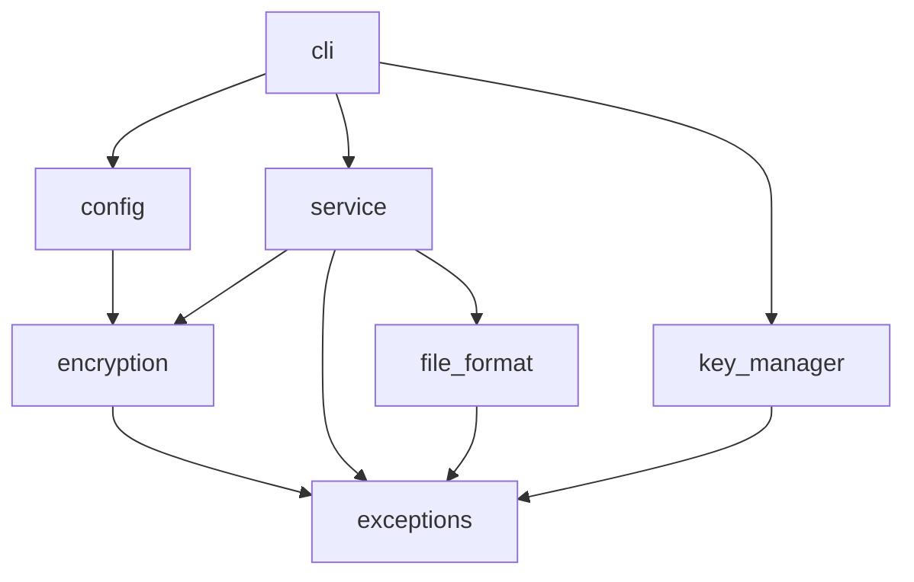

# Arquitectura

## Principios de diseño

1. **Un solo lugar toca las primitivas criptográficas** (`encryption.py`). El resto de módulos trabajan con la interfaz `CipherProvider`.
2. **Los archivos son autodescriptivos**: la cabecera lleva versión y algoritmo, así que descifrar no depende de la configuración actual.
3. **Fallar de forma segura**: ante cualquier fallo de autenticación o formato no se escribe nada.
4. **Errores explícitos**: jerarquía de excepciones propia; la CLI es el único sitio que las convierte en mensajes y códigos de salida.
5. **Cero secretos en el código, en consola o en logs.**

## Dependencias entre módulos

Las flechas siempre apuntan "hacia abajo": ningún módulo de bajo nivel conoce a los de alto nivel, y `service.py` nunca importa `AESGCM`.

## Formato del archivo (versión 1)

| Offset | Tamaño | Campo | Notas |
|---|---|---|---|
| 0 | 4 | Firma `CAGL` | Detecta archivos que no son de esta herramienta |
| 4 | 1 | Versión | Permite evolucionar el formato (v2: streaming, KEM...) |
| 5 | 1 | Id de algoritmo | 1 = aes-256-gcm. Los ids **no se reutilizan nunca** |
| 6 | 1 | Longitud de nonce (N) | 1-255; se valida contra el algoritmo |
| 7 | N | Nonce | Público, aleatorio, único por cifrado |
| 7+N | resto | Texto cifrado + etiqueta | La etiqueta (16 B) va al final |

La cabecera completa se pasa como **AAD** a GCM. Modificar cualquier byte de la cabecera (incluido el nonce) hace fallar la autenticación; versión y algoritmo se validan además antes de intentar descifrar para dar mensajes claros.

## Decisiones de diseño y su motivo

| Decisión | Motivo |
|---|---|
| Descifrar en memoria y escribir solo tras verificar | Garantiza "no archivos parcialmente descifrados" |
| Escritura atómica (temporal + `os.replace`) | Un fallo a mitad de escritura no deja un archivo corrupto en el destino |
| Mismo mensaje para "clave incorrecta" y "archivo alterado" | Son indistinguibles criptográficamente y no se da información extra a un atacante |
| `--force` obligatorio para sobrescribir | Evita destruir datos o claves por error |
| `encrypt` no borra el original | La herramienta no decide por el usuario; el borrado seguro es otro problema (ver limitaciones) |
| Clave en archivo Base64 aparte | Separación clave/datos; formato de texto fácil de respaldar |
| Cabecera con id de algoritmo | Agilidad: coexisten archivos de distintos algoritmos |
| Configuración estricta (claves desconocidas = error) | Detectar erratas en vez de usar silenciosamente el valor por defecto |

## Puntos de extensión

- **Nuevo algoritmo:** [`anadir-un-algoritmo.md`](anadir-un-algoritmo.md).
- **Nuevo formato (v2):** `parse_header` rechaza versiones desconocidas; un v2 añadiría su propia rama de análisis manteniendo la lectura de v1.
- **Nuevo origen de clave** (contraseña con KDF, KMS): sustituir/ampliar `key_manager.py`; `service.py` solo necesita `bytes`.
